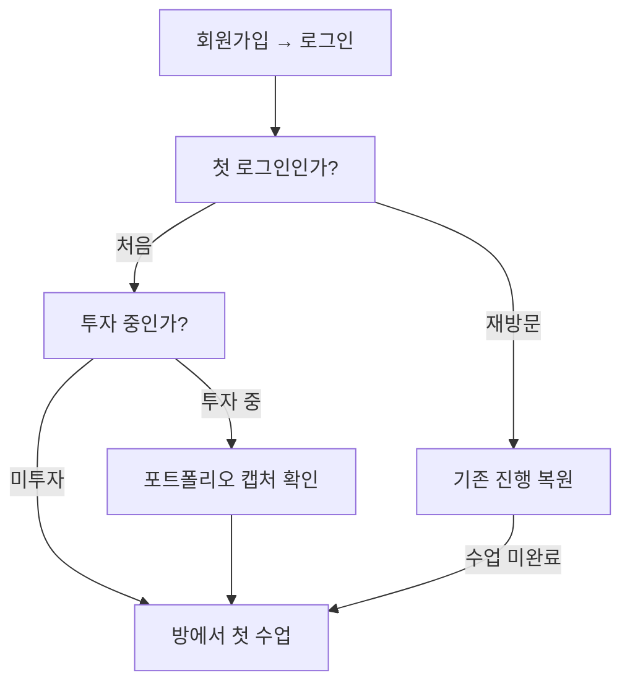
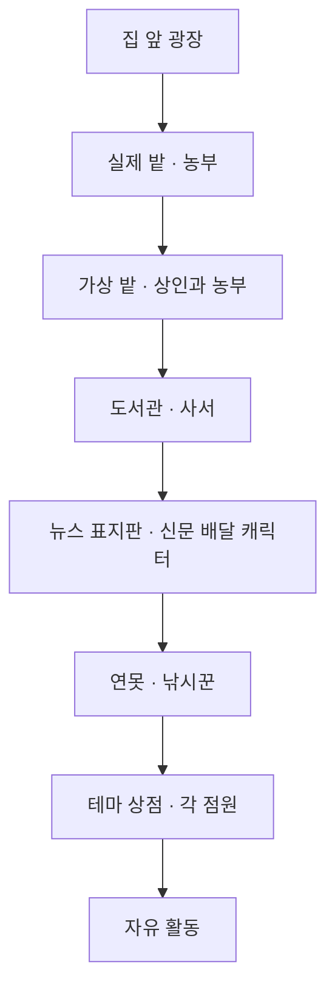
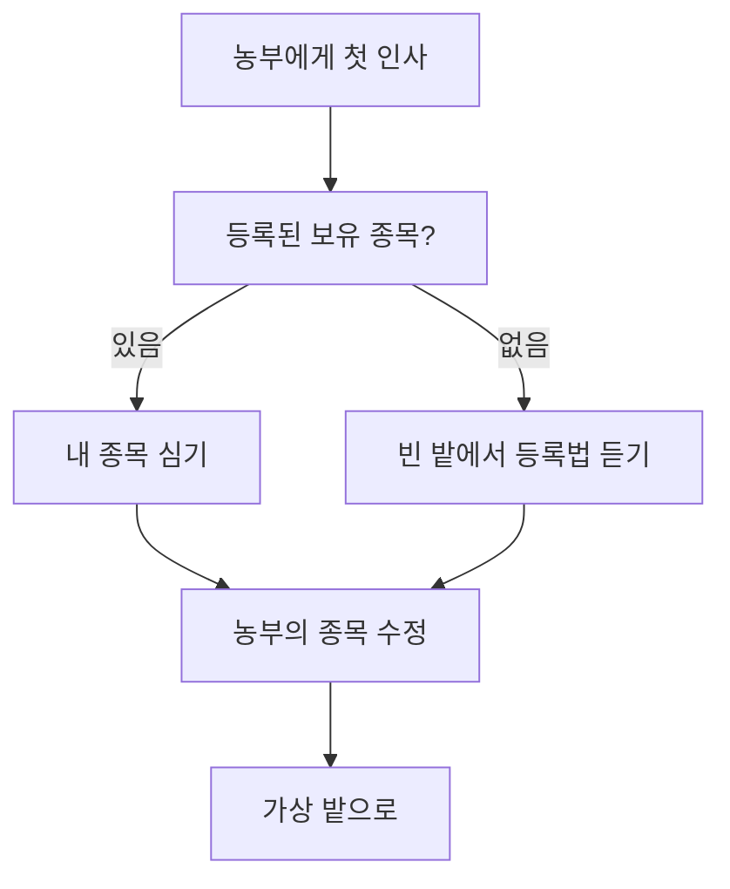
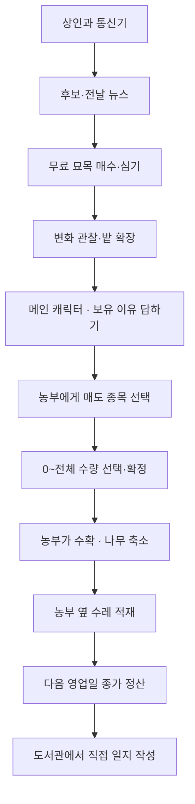
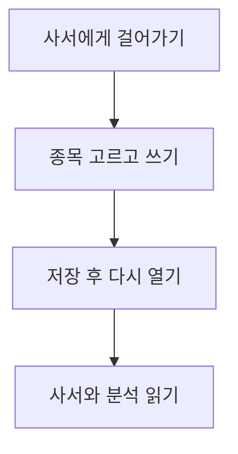
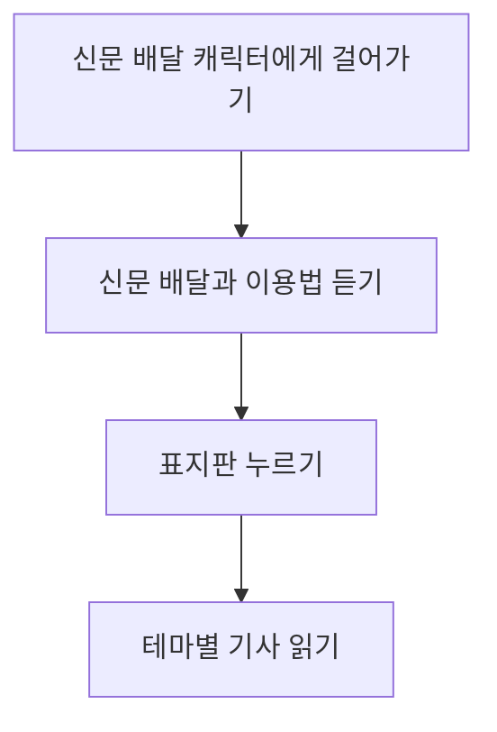
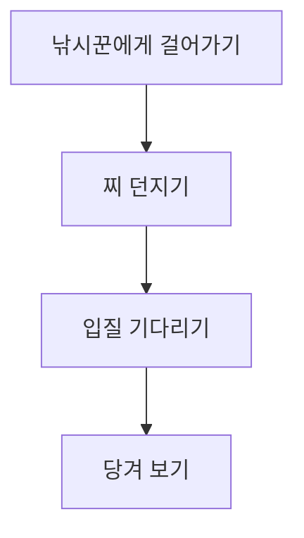
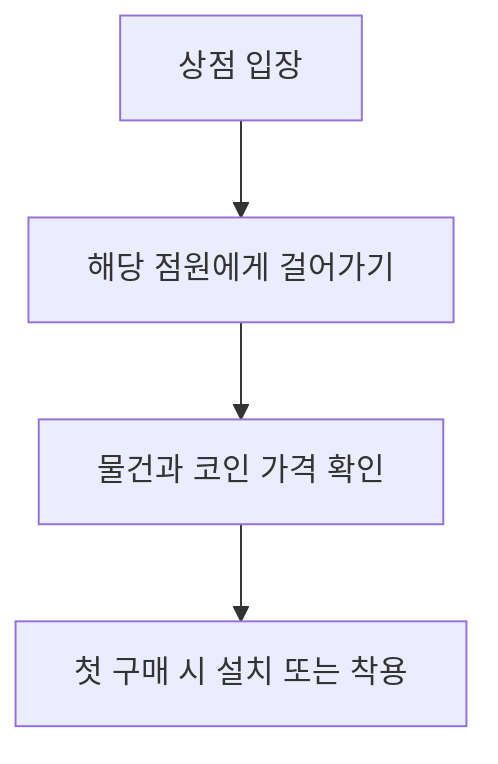
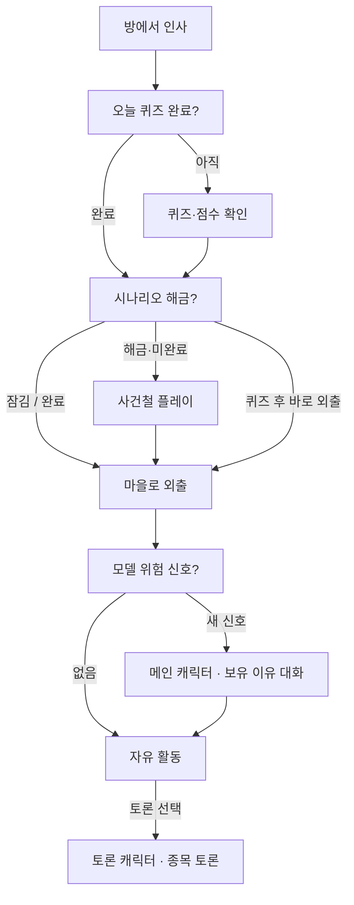

# 다시 생각해볼래? · 유저 워크플로우

2026.11.21 · 기획 및 구현 기준

첫 로그인 → 방 수업 → 실제 밭 → 가상 밭 → 도서관 → 뉴스 표지판 → 낚시 → 상점. 이후에는 매일 집에서 시작해 마을에서 자유롭게 활동한다.

## 1. 입장과 첫 수업

회원가입과 첫 로그인 절차를 마치면 두 유저 모두 같은 3D 방에서 보리와 눈을 맞춘다.

**계정 입구**  
투자 중이면 보유 목록 캡처를 올린다. 읽어 낸 종목·수량·평가액·수익률을 확인하고 누락값만 고친다. 읽기 실패 시 재촬영하거나 직접 확인한다. 확인된 목록은 농부를 만날 때 쓴다. 미투자 유저는 빈 목록으로 방에 들어간다.

**방의 첫 장면**  
앉은 눈높이의 1인칭. 책상 너머 보리가 손을 흔든다. “오늘은 나랑 문제 하나 풀어 보자.” 보리가 종이를 내밀 때 퀴즈 종이만 밝아진다. 유저가 종이를 눌러야 다음 동작으로 넘어간다.

**레벨을 알려주는 동작**  
보리가 연필 끝으로 현재 레벨 눈금을 짚는다. “퀴즈를 풀면서 여기까지 자라는 거야.” 다음에는 옆 서랍으로 몸을 돌린다. 자물쇠에 현재 레벨과 ‘퀴즈 Lv.5에 열려요’가 뜬다. Lv.5는 기존 설계의 제안값이며 실제 기준값을 판정과 문구가 함께 사용한다.

**첫 문제를 직접 풀기**  
보리를 따라 종이를 펼치고 보기 하나를 누른다. 제출하면 보리가 뒷면의 해설 한 줄을 짚는다. 풀이가 끝나면 문이 열리고 보리가 문을 바라본다. 사용자가 문을 선택하면 마을 3인칭 시점으로 전환한다.

## 2. 마을 첫 산책

광장에서 전체 방향을 먼저 보고, 각 장소에서는 그곳의 캐릭터에게 직접 배운다.

**보리가 보여 주는 길**  
집 앞에서 보리가 두 밭과 도서관 쪽을 차례로 바라본 뒤 “먼저 저 밭의 농부한테 가 보자”라고 한다. 발밑 길과 다음 NPC 한 명만 강조한다.

**마을 공통 · 접근과 대화 시점**  
첫 방문과 재방문 모두 같은 순서로 대화한다. 멀리서 상대를 누르면 3인칭 시점을 유지한 채 내 캐릭터가 상대 앞으로 걸어간다. 이동 중에는 대사가 시작되지 않는다. 상대 앞 대화 거리 안에 도착해 멈추면 두 캐릭터가 서로 몸을 돌린다. 카메라가 내 캐릭터의 눈높이로 옮겨져 상대 얼굴을 정면으로 바라보는 1인칭이 된 뒤 첫 대사와 선택지가 나타난다. 이미 대화 거리 안에서 눌렀다면 걷는 단계만 생략한다. 도착 전에 이동을 취소하거나 길이 막히면 대화는 시작하지 않는다. 대화를 끝내면 같은 자리에 3인칭 시점이 돌아오고 다시 걸을 수 있다. 첫 방문의 모든 단계에서 조작하기 전에 목적지까지의 길, 도착할 NPC, 그다음 만질 물건을 차례로 강조한다. 예를 들어 매도 차례에는 농부 앞까지 발자국이 이어지고, 도착하면 매도 종목과 수량 바가 차례로 밝아진다. 다른 NPC나 물건을 눌러도 해당 기능은 열리지 않는다. 보리가 “지금은 농부에게 열매를 몇 개 딸지 알려 주자”라고 짧게 말하고 아바타는 현재 목표 앞으로 이동한다. 수량 선택과 확정은 유저가 직접 한다. 해당 행동을 끝낸 뒤에만 다음 목표로 강조를 옮긴다. 마지막 상점 안내를 마치면 자유 이동과 상호작용이 열린다.

**중단과 복귀**  
각 장소의 마지막 실습을 마친 시점과 진행 중 행동을 저장한다. 재입장하면 방에서 시작하고 오늘 퀴즈를 마쳤으면 열린 문으로 바로 간다. 보리는 아직 끝내지 않은 장소부터 길을 짚는다.

## 3. 실제 종목 나무밭

농부는 실제 보유 내역을 밭에 옮기고, 나중에 수량이 바뀔 때 찾아갈 사람이다.

**이미 투자 중**  
첫 대화를 시작하면 농부가 캡처로 확인한 종목의 묘목을 직접 심어 준다. 첫 9칸을 넘으면 심을 9종목을 선택하고 나머지는 대기 목록에 보관한다. 10~12번째는 코인으로 3칸 확장한 뒤 심는다.

**아직 투자하지 않음**  
농부가 빈 두둑을 가리키며 “나중에 실제로 가진 종목이 생기면 나한테 알려 줘.” 실제 보유를 꾸며 넣지 않고 무료 체험 나무가 있는 가상 밭으로 안내한다.

**농부를 다시 찾으면**  
‘종목 수정’에서 추가 매수·일부 매도·전량 매도와 변동 수량을 입력해 확인한다. 실제 거래는 사용자가 별도로 한 것이며 여기서는 기록을 고친다. 실제·가상 밭 모두 각 종목의 현재 보유액수에 따라 나무 크기를 연속적으로 정한다. 같은 보유액수면 다른 종목을 더 사더라도 이 나무의 크기는 같다. 수익률은 잎과 가지의 모습에 반영한다. 이름표에는 종목명을 적는다. 두 밭에서 나무를 누르면 매수시점·평단가·수익률·보유액수·기업 개요를 읽는 종목 상태 창이 열린다. 닫으면 같은 나무 앞으로 돌아온다. 이 창은 조회 전용이며 일지 열기·작성·수정과 거래 버튼은 두지 않는다. 9칸에서 12칸으로 넓히는 조작은 다음 가상 밭에서 연습한다.

## 4. 가상 종목 나무밭

상인의 통신기를 만져 보고, 무료 나무 한 그루로 매수부터 수레 정산까지 직접 연습한다.

**상인이 있는 시간**  
한국 시각 08:00 이상 20:00 미만에 상인이 밭에 선다. 매일 무작위 실제 종목 5개가 통신기에 뜨며 같은 날 다시 열면 같은 후보를 본다. 매수는 상인을 통해서만 한다. 영업시간 밖에 처음 도착하면 빈 상인 자리에 다음 등장 시각을 표시하고 ‘상인 만나기’ 단계를 저장한다. 다음 영업시간에 실제 상인을 누르면 그 앞까지 걸어가 첫 체험을 시작한다. 이미 보유한 가상 나무의 수확은 언제든 가능하다.

**통신기로 첫 매수**  
상인이 자기 통신기를 건넨다. 시나리오에서 쓰는 증권앱 UI를 재사용한다. 유저가 후보 종목 하나를 누르고 옆의 전날 뉴스에서 자료 한 건을 읽은 뒤 매수 수량과 코인 비용을 확인한다. 첫 체험에서는 유저가 주문을 확인하고 빈칸을 짚으면 상인이 무료 나무 한 그루를 그 자리에 심어 준다. 이후 가상 보유는 게임 코인과 실제 종목 등락률을 사용한다.

**눈으로 비교하고 직접 확장**  
연습 시간축을 움직여 같은 나무의 수익·손실에 따른 외형 변화를 본다. 무료 나무를 직접 눌러 종목 상태를 읽고 닫는다. 연습용 보유 수량을 늘려 보유액수가 커질 때 나무가 부드럽게 자라는 모습을 확인한다. 9칸이 찬 연습 밭에 열 번째 묘목을 놓아 보고 ‘3칸 확장’을 누른다. 연습 코인 차감과 9→12칸 변화를 직접 확인한다. 예시 배치·연습 비용은 사용자 잔고와 실제 밭에 반영하지 않는다.

**위험 신호 실습**  
연습 신호가 오면 메인 캐릭터가 나무 곁으로 걸어온다. “이 종목에서 위험 신호가 잡혔어. 지금도 갖고 있으려는 이유가 뭐야?” 유저가 직접 답하거나 나중에 답하기를 고른다. 연습 이벤트로 표시해 실제 보유 종목 경보와 구분한다.

**매도와 다음 종가**  
상인의 영업시간과 관계없이 농부를 눌러 그 앞으로 걸어간다. ‘가상 종목 매도’에서 종목을 고르면 좌우 수량 바의 양 끝에 0과 현재 매도 가능한 전체 수량이 보인다. 바를 클릭하거나 끌어 수량을 고른다. 0에서는 확정할 수 없고, 전체를 선택하면 전량을 수확한다. 확정해야 농부가 해당 나무까지 걸어가 선택한 수량만큼 열매를 딴다. 나무는 남은 수량의 보유액수에 맞춰 연속적으로 작아진다. 농부가 자기 자리 옆 수레로 돌아와 열매를 싣는다. 수레 위 열매 더미는 적재 수량만큼 커진다. 이때 수확 수량은 정산 대기로 옮겨져 다시 선택할 수 없고 코인 잔액은 그대로다. 수레표에는 수량·예정 정산일·정산 대기가 적힌다. “수레가 가져간 열매는 다음 장이 끝날 때 팔려.” 다음 거래일 종가 등락률이 확정된 뒤 코인을 한 번 지급한다. 예를 들어 오늘 종가 기준 수레 가치 100코인, 다음 거래일 +3%이면 103코인이다. 휴장일에는 다음 거래일로 넘긴다.

**체험을 마칠 때**  
첫 체험에서는 연습 수량으로 농부의 수확, 나무 축소, 수레 적재를 직접 진행한다. 유저가 연습 시계를 다음 영업일 종가로 넘기면 수레가 비고 연습 정산액이 표시된다. 체험을 마치면 무료 나무는 보유 상태로 남는다. 실제 가상 매도 주문은 다음 영업일 종가가 확정될 때 판매 완료로 바뀌고 코인이 지급된다. 다음 목적지로 도서관 입구가 강조된다. 사서가 예제로 쓰는 것은 방금 심은 종목이며, 위험 신호 대화에서 오간 질문·답은 도서관으로 전송하거나 일지에 자동 입력하지 않는다.

## 5. 도서관 · 사서

도서관에서 사서를 만나 기존 UI의 종목별 투자일지를 열고, 무료 나무의 종목으로 첫 기록을 직접 작성한다. 도서관에는 유저가 작성한 투자일지만 기록한다.

**사서의 책상**  
도서관에 들어가 사서를 누르면 아바타가 책상 앞으로 걷는다. 사서가 무료 나무의 이름표를 꺼낸다. “아까 심은 나무 이름을 찾아볼까?” 유저가 그 종목 색인을 누르면 사서가 빈 날짜 칸을 짚는다. “왜 심었는지 한 줄 써 보자.” 기존 일지의 ‘오늘의 나 → 종목과 차트 → 가설 → 기한과 확신’ 작성 순서를 따라간다. 사서는 현재 입력할 칸 하나만 짚고 유저가 직접 적을 때까지 기다린다. 저장과 다시 열기도 기존 투자일지 기능을 사용한다.

**저장과 분석도 한 번씩**  
유저가 저장하면 종목 책의 오늘 날짜에 갈피가 꽂힌다. 책을 덮었다가 같은 색인을 열어 방금 쓴 문장을 찾는다. 사서가 갈피를 하나씩 넘긴다. ‘요약’은 쌓인 기록을 묶어 보고, ‘분야·논리’는 어떤 자료를 어떤 이유에 연결했는지 보고, ‘판단 변화’는 같은 종목에 대한 이전·이후 생각을 비교한다. 첫 기록뿐이면 비교에 필요한 다음 기록을 안내하고 완성 예시는 연습본으로 보여 준다.

## 6. 뉴스 표지판 · 신문 배달 캐릭터

광장의 큰 표지판에서 오늘 배달된 보유 종목 뉴스를 읽는다.

**신문 배달과 표지판**  
도서관을 나오면 광장의 신문 배달 캐릭터와 그에게 가는 길이 강조된다. 그를 누르면 유저가 표지판 앞으로 걸어간다. 신문 배달 캐릭터가 배달 가방에서 오늘 신문을 꺼내 꽂으며 “네가 가진 종목 소식을 모아 왔어. 궁금한 주제를 하나 짚어 볼래?”라고 한다. 신문 배달 캐릭터가 매일 보유 종목 관련 기사를 배달한다. 표지판을 눌러 테마를 고르고 기사 제목·관련 종목·날짜를 확인한다. 관련 기사가 없으면 빈 이유를 표시한다. 상인 통신기의 전날 뉴스는 매수 후보 기준이다.

## 7. 연못 · 낚시꾼

낚시꾼 앞에 도착한 뒤 낚싯대를 받아 한 번 직접 낚는다.

**연못**  
낚시꾼을 누르고 앞으로 걸어간다. 그가 찌를 가리키면 직접 던지고, 찌가 잠길 때 당겨 한 번 체험한다. 놓치면 바로 다시 던진다.

## 8. 건물 상점과 옷 상점 · 각 점원

입장한 상점의 점원이 판매하고 첫 구매 뒤 사용 장소까지 알려 준다.

**테마 상점**  
건물 상점과 옷 상점 안에서 각 점원이 테마에 맞는 물건과 코인 가격을 보여 준다. 구매 확정 뒤 옷은 내 캐릭터의 옷장으로 가서 착용하고, 건물은 마을 꾸미기에서 자리를 정해 설치한다. 품목 종류별 첫 구매 때만 해당 동선을 안내한다. 잔액이 부족하면 둘러본 뒤 산책을 끝낼 수 있고 첫 구매 안내는 실제 구입 시점에 뜬다.

## 9. 재방문과 일상

보리는 매일 방에서 인사한다. 익숙한 장소에서는 곧바로 행동을 시작한다.

**오늘의 수업과 보상**  
오늘 퀴즈를 함께 풀고, 해금 기준에 도달하면 보리가 잠금을 열고 첫 사건철을 꺼낸다. 해금 전 하루 과제는 퀴즈, 해금 후에는 퀴즈와 시나리오다. 각각 기준 점수 이상이면 코인을 한 번 지급한다. 점수가 낮아도 활동은 완료된다. 퀴즈 완료로 열린 문은 그날 재입장해도 열려 있다.

**시나리오에서 하는 일**  
보리와 사건철을 펼치고 그 시점의 자료와 뉴스, 상인 통신기와 같은 증권앱 UI에 표시된 차트·보유량을 살핀다. 시장 시계가 멈추면 가설과 보유·부분 매도를 확정한다. 다음 구간을 재생해 새 자료로 판단을 갱신한다. 결과 첫 장에서 내 성과·계속 보유 성과·실제 사건과 거장의 공시상 선택을 보고, 다음 장에서 내 일지 피드백을 읽는다. 이후 의뢰는 서버에만 둔다.

**마을의 실제 신호**  
보유 종목에 모델 신호가 오면 메인 캐릭터가 유저 앞으로 다가온다. 대화 거리 안에 도착하면 서로 마주 보고 유저의 1인칭 시점으로 전환한다. 그때 종목명과 관측 근거를 짚고 계속 보유하는 이유를 묻는다. 방에 있을 때 온 신호는 마을 입장 직후, 마을에 있으면 조작 가능한 첫 순간에 전달한다. 같은 사건은 반복 호출하지 않는다.

**원하는 활동**  
농부와 보유 내역 수정, 상인 영업 중 매수, 언제든 농부에게 가상 종목 매도 요청, 도서관 일지, 표지판 뉴스, 낚시 등 미니게임, 쇼핑·꾸미기를 자유롭게 고른다. 토론 캐릭터를 누르면 앞으로 걸어간다. 대화 거리에서 상대를 마주 보는 1인칭으로 전환한 뒤 종목을 골라 LLM 대화를 시작한다. 사용자의 근거를 듣고 반대 근거나 다시 확인할 조건을 묻는다. 대화를 끝내면 그 자리에 돌아온다.

## 운영 결정과 진행 기록

해금 Lv.5는 제안값이다. 퀴즈 레벨 산식, 미션별 보상 기준·코인 액수, 밭 확장 가격은 운영 설정으로 남긴다. 시간은 한국 기준이며 “다음날 종가”는 다음 거래일 종가로 해석했다. 무료 나무를 보존하는 연습 매도, 품목 종류별 첫 구매 안내는 동선이 끊기지 않게 하기 위한 제안이다.

계정별로 첫 로그인 응답, 수업·장소별 완료 단계, 무료 나무 지급 여부, 품목 종류별 첫 구매 안내, 날짜별 퀴즈·시나리오 완료 및 보상, 수레별 예약 수량·정산 상태를 저장한다. 겹치는 요청에서도 나무·코인 지급과 수레 정산은 각 건당 한 번만 처리한다.

---

## 구현 상태 (2026-11-21, 1차)

위는 PM 문서 그대로다. 아래는 1차로 만든 것과 남은 것이다.

### 만든 것

- **입장.** 첫 화면에서 캡처, 직접 입력, 또는 새로 생긴 "아직 투자 안 해요"를 고른다. 확인한 목록은 저장만 하고 심지 않은 채 방으로 들어간다.
  - 화면은 `ui/Onboarding.tsx`이고, 흐름은 `Proto3D.tsx`의 `firstIn`이다.
- **방의 첫 수업** (`ui/House.tsx`의 `Lesson`)
  - 순서는 이렇다.
    1. 보리가 손을 흔들고 퀴즈 종이만 빛난다(`House3D`의 `paper='glow'`). 종이를 누르면 다음으로 간다.
    2. 레벨 게이지가 밝아진다.
    3. 서랍 자물쇠가 밝아진다("퀴즈 Lv.5에 열려").
    4. 종이 한 장을 풀고 뒷면 해설을 본다.
    5. 문이 열린다.
  - 수업을 마친 날짜는 `rethink-lesson-v1`에 남고, 그날은 문이 열려 있다.
- **마을 첫 산책** (로직 `core/walk.ts`, 사람 `content/villagers.ts`, 3D `Village3D.tsx`, 화면 `ui/Walk.tsx`)
  - 순서: 광장(보리) → 농부 → 상인 → 농부(매도 연습) → 사서 → 신문 배달 → 나루 → 건물 점원 → 옷 점원 → 자유.
  - 저장 키는 `rethink-walk-v1`이다.
  - 마을 사람은 내 캐릭터 모델에 일옷을 입혀 세웠다.
  - 다음에 갈 사람에게는 고리와 화살표가 붙고, 발밑에 점선 길이 생기며, 위쪽에 안내가 뜬다.
  - 다른 사람을 누르면 보리 힌트가 나오고 아바타가 지금 목표에게 걸어간다.
  - 대화는 이렇게 열린다.
    - 멀리서 누르면 걸어가고, 걷는 동안에는 대사가 없다.
    - 도착해서 멈추면 서로 몸을 돌리고, 카메라가 내 눈높이 1인칭으로 바뀐 뒤 대사가 나온다(`world.talk.eye`, `LOOK.camera.eyeTalk`).
    - 다른 데로 걸어가 버리면 대화가 열리지 않는다.
  - **농부**: 입장 때 확인한 종목을 직접 심어 준다(심는 연출 포함). 목록이 비었으면 등록하는 법만 알려 준다. 산책 뒤에는 "종목 수정"과 "가상 종목 매도"를 맡는다.
  - **상인**: 한국 시각 08:00~20:00에만 있다(`merchantHere`).
    - 영업시간 밖에는 가판대만 있고 "오전 8시에 와요"가 뜬다. 산책 중이면 도서관부터 가고, `merchantWait`가 남는다.
    - 통신기에는 그날 무작위 5종목이 뜨고, 같은 날에는 같은 5종목이다. 전날 뉴스를 읽어야 주문할 수 있고, 첫 손님은 1주가 무료다(`freeVirtual`, 계정당 한 번).
  - **매도와 수레**
    - 수량 바는 0부터 전체까지 있고, 0이면 확정할 수 없다.
    - 확정하면 나무에서 수량이 빠져 나무가 작아지고, 수레에 실린다. 이때 코인은 그대로다.
    - 다음 거래일 종가가 나오면 한 번만 지급한다(`cartLoad`, `cartSettle`, `settleCart`).
    - 첫 산책 때는 연습 수량 10주로 하고, 연습 시계를 넘겨 정산액만 보여 준다.
  - **사서**: 무료 나무 종목으로 기존 일지 쓰기를 연다. 저장하면 다음으로 넘어간다.
  - **신문 배달과 뉴스 표지판**: 내 보유 종목 예시 기사를 테마별(실적·업황·정책·공시)로 보여 준다. 기사가 없으면 이유를 적는다(`content/village-news.ts`).
  - **나루**: 한 번 낚으면 다음으로 넘어간다.
  - **건물 점원과 옷 점원**: 꽃집(꾸미기)과 옷장을 연다.
- **나무**
  - 크기는 지금 보유액수만큼 연속으로 바뀐다(`treeSize`, `worthOf`). 잎과 열매는 수익률을 따른다.
  - 나무를 누르면 조회 전용 상태 창이 열린다(`TreeStatus`: 매수 시점, 평단가, 수익률, 보유액수, 기업 개요).
- **밭**: 처음 9칸이고, 코인으로 3칸을 넓혀 12칸이 된다. 밭과 과수원 모두 같다(`core/land.ts`). 앞길은 4번째 줄 아래로 옮겼다.

### 아직 안 한 것 (다음 차례)

- 가상 밭의 연습 3종: 연습 시간축으로 나무 모양 비교하기, 9칸이 찬 연습 밭을 3칸 넓히기, 연습 위험 신호에 메인 캐릭터가 질문하기.
- 사서가 칸 하나씩 짚어 주기, 저장 뒤 요약·분야·판단 변화 갈피를 하나씩 넘겨 보이기.
- 상점에서 품목 종류별 첫 구매 뒤 설치·착용까지 안내하기(`firstBuy` 칸만 만들어 둠).
- 9장 재방문: 마을의 실제 신호는 기존 보리 다가오기를 그대로 쓴다. 토론 캐릭터 LLM 대화는 아직 없다.
- 실제 뉴스 연결(지금은 예시 기사), 농부 종목 수정의 추가 매수·일부 매도 입력(지금은 기존 종목 편집 화면).
